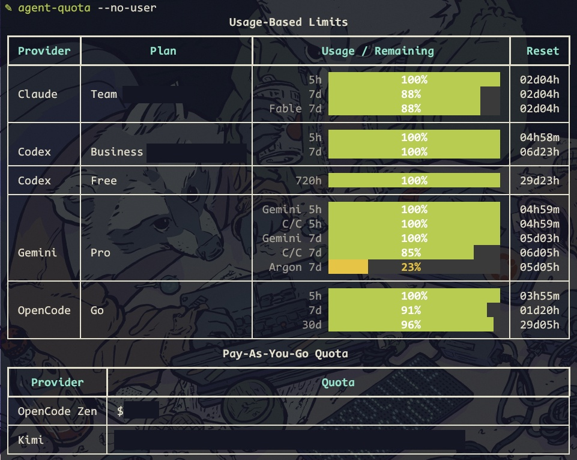
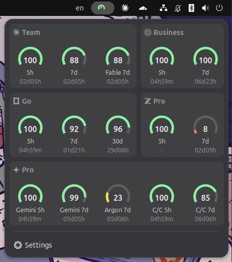

# agent-quota

> One quota tracker for the AI coding tools you actually use: a terminal table, a GNOME popup, and a shared provider backend.

[](pyproject.toml)
[](#gnome-popup)
[](LICENSE)

<p align="center">
  
  
</p>

<p align="center">
  <sub><strong>CLI</strong> — scriptable terminal tables &nbsp;&nbsp;·&nbsp;&nbsp; <strong>GNOME popup</strong> — a shared gauge grid in the top panel</sub>
</p>

`agent-quota` keeps subscription windows, rate limits, credits, and prepaid balances visible for **Claude**, **OpenAI Codex**, **GitHub Copilot**, **Z.ai**, **Gemini (Antigravity)**, **OpenCode**, **OpenRouter**, **DeepSeek**, **Kimi (Moonshot AI)**, and **Google Colab**. It reuses the sessions and credentials you already have — browser cookies, OAuth, API keys, or local CLI files — and never stores passwords.

## Why

- **Plan around resets, not guesses.** See the remaining percentage, the reset countdown, and which window is actually blocking you.
- **Two surfaces, one backend.** The terminal table and the GNOME popup use the same provider adapters, cache, and credential handling, so they never disagree.
- **Credits are not rate limits.** Codex workspace credits, OpenCode Zen balances, OpenRouter credits, DeepSeek, Kimi, and Colab compute units are shown as balances instead of pretending to be rolling windows.
- **Make the popup yours.** Arrange provider cards on a shared grid, reorder gauges, and tune spacing, padding, gauge size, and percentage display.
- **Privacy-first.** Credentials stay in local config files or browser sessions. The GNOME settings page runs on localhost and writes API keys write-only.

## Install

### CLI

Requires Python 3.11+ and [uv](https://docs.astral.sh/uv/).

```bash
# from a clone
uv sync
uv run agent-quota

# or install it as a uv tool
uv tool install .
agent-quota
```

### GNOME popup

The GNOME popup is delivered by a **GNOME Shell extension**. It supports GNOME 50 on Wayland and X11.

```bash
./install-gnome-extension.sh
gnome-extensions enable agent-quota@torridfish
```

The installer packages the Python backend into the extension and refreshes the matching global `agent-quota` command, keeping terminal and popup output in sync. `uv` is required. The browser settings server uses the system `/usr/bin/python3` with PyGObject (`python3-gi`); on Debian/Ubuntu install it with:

```bash
sudo apt install python3-gi
```

On GNOME 50 Wayland, log out and back in once after installing or updating if the installer reports that the in-memory extension module is still old.

## Quick start

```bash
agent-quota                       # one-shot CLI table
agent-quota setup                 # choose providers and save config.toml
agent-quota --watch               # refresh every 15 seconds
agent-quota --watch 30            # custom refresh interval
agent-quota --only claude,codex   # one-off provider subset
agent-quota --view usage          # usage-based limits only
agent-quota --view payg           # pay-as-you-go balances only
agent-quota --no-user             # hide the User column
agent-quota --json                # machine-readable JSON for integrations
```

Click the gauge in the right side of the GNOME top bar to open the **GNOME popup**. A red/yellow gauge means low quota; a small `!` badge means one or more provider fetches failed. Long provider errors are capped so the popup stays usable.

Open **Settings** at the bottom of the popup, or run `gnome-extensions prefs agent-quota@torridfish`, to configure the extension in your browser. The GTK window is only a short-lived launcher; the settings page is the browser app.

## Features

### CLI

- Terminal tables for usage windows and pay-as-you-go balances, with colour thresholds, reset countdowns, and optional plan/user metadata.
- Watch mode, provider subsets, usage/payg views, JSON output, and per-provider cookie-browser selection.
- Stable cache files under `~/.cache/agent-quota/`, safe for concurrent one-shot and watch runs.

### GNOME popup

- One shared gauge grid across every provider card: gauges line up on the same columns and rows across cards.
- A visual layout editor with drag-to-arrange cards, drag-to-reorder gauges, card gauge-column controls, undo/redo, reset, and JSON import/export.
- Shared controls for grid columns (1–5), gauge spacing, card gap, card padding, and reset display.
- Gauge styling controls: 240° arc, percentage text mode, percentage offset, font sizes, and gauge radius.
- Provider headers with icon, plan, and optional user/organisation information.
- A localhost settings server with a one-time token, write-only credential handling, and automatic idle shutdown.

## Providers

| Provider | Source | What it shows |
|---|---|---|
| **Claude** | Browser cookies | Plan/team/user metadata and reported 5-hour and 7-day windows |
| **OpenAI Codex** | Browser cookies | Standard-seat 5-hour/7-day windows; workspace credit allowance when spend controls expose it; legacy usage-based seats show credits only |
| **GitHub Copilot** | GitHub PAT or browser cookies | Monthly included Copilot quota and remaining allowance |
| **Z.ai** | API token (web JWT or GLM Coding Plan key) | Quota windows and remaining allowance |
| **Gemini (Antigravity)** | `agy` OAuth credentials | Per-pool 5-hour and 7-day windows (Gemini, C/C, Argon, and other reported pools) |
| **OpenCode Go** | `opencode auth login` | 5-hour, 7-day, and 30-day windows |
| **OpenCode Zen** | Browser cookies | Workspace credit balance |
| **OpenRouter** | Management API key | Credit balance |
| **DeepSeek** | API key | Prepaid credit balance |
| **Kimi (Moonshot AI)** | API key | Available balance, including cash/voucher split |
| **Google Colab** | `colab` CLI OAuth token | Remaining compute units (CU) against a 200 CU display cap |

Pay-as-you-go balances are secondary to subscription windows, but remain first-class rows. Usage-based bars show the **remaining** allowance; colour shifts to yellow below 30% and red below 10%. When a provider-wide 7-day window is exhausted, its other percentage bars turn muted gray-green because they are no longer actionable. Rows without a percentage render as plain text. A zero Codex workspace credit balance keeps its percentage but renders neutral gray because the seat cannot spend it.

## Authentication

| Provider | Authentication |
|---|---|
| Claude | Be logged into [claude.ai](https://claude.ai) in any supported browser. |
| Codex | Be logged into [chatgpt.com](https://chatgpt.com). |
| Copilot | Put a GitHub PAT with **Plan (read)** permission in `~/.config/agent-quota/copilot.conf`, or be logged into github.com for org-managed Copilot. |
| Z.ai | Put a web JWT or GLM Coding Plan API key in `~/.config/agent-quota/zai.conf`. |
| Gemini (Antigravity) | Be signed in through the `agy` CLI. No token file is needed; expired access tokens are refreshed from `agy`'s embedded OAuth client credentials and cached under `~/.cache/agent-quota/`. |
| OpenCode Go | Run `opencode auth login` once; the key is read from `~/.local/share/opencode/auth.json`. |
| OpenCode Zen | Be logged into [opencode.ai](https://opencode.ai/zen). |
| OpenRouter | Put a management key in `~/.config/agent-quota/openrouter.conf`. |
| DeepSeek | Put an API key in `~/.config/agent-quota/deepseek.conf`. |
| Kimi | Put an API key in `~/.config/agent-quota/moonshot.conf`. |
| Colab | Run `colab usage` (or any `colab` command) once; the token in `~/.config/colab-cli/token.json` is reused read-only. |

Supported cookie sources: `chrome`, `chromium`, `brave`, `edge`, `firefox`, `helium`. The first one with a valid session wins. Override the order with `--browser <name>` (repeatable), or for one provider with `--provider-browser KEY=NAME` (repeatable), for example:

```bash
agent-quota --browser firefox
agent-quota --browser firefox --provider-browser claude=chrome
```

Cookie-authenticated providers cache per browser preference, so switching browsers never returns another browser's cached account.

## Configuration

The first time you run `agent-quota` without a config file, it prompts you to choose which providers to monitor and writes `~/.config/agent-quota/config.toml`:

```toml
# agent-quota configuration
# Edit this file or run `agent-quota setup` to change.
enabled = ["claude", "codex", "copilot"]
```

For API-auth providers, `agent-quota setup` offers to collect the key inline and writes the matching per-provider config file. Re-run `agent-quota setup` any time to change the selection or update saved keys. `--only` overrides the configured set for one invocation. If stdin/stdout are not a TTY, the prompt is skipped and the tool falls back to all providers.

### Copilot

```ini
# ~/.config/agent-quota/copilot.conf
GITHUB_TOKEN=github_pat_...   # fine-grained PAT with "Plan (read)" permission
COPILOT_QUOTA=300             # monthly included quota; default 300
```

Org-managed Copilot accounts can omit `GITHUB_TOKEN`; the tool falls back to the GitHub Copilot settings page using browser cookies.

### Z.ai

```ini
# ~/.config/agent-quota/zai.conf
ZAI_TOKEN=your-Z.ai-api-key   # web JWT or GLM Coding Plan key
```

For a web session JWT: open [z.ai](https://z.ai), open DevTools → Network, find an `api.z.ai` request, and copy the `Authorization` value **without** the `Bearer ` prefix. GLM Coding Plan API keys are also accepted. The monitor expects the raw token, and Coding Plan tools must use the dedicated `https://api.z.ai/api/coding/paas/v4` endpoint; the general endpoint does not consume Coding Plan quota.

### OpenRouter

```ini
# ~/.config/agent-quota/openrouter.conf
OPENROUTER_API_KEY=sk-or-...
```

Use a management key with access to `GET /api/v1/credits`.

### Kimi (Moonshot AI)

```ini
# ~/.config/agent-quota/moonshot.conf
MOONSHOT_API_KEY=sk-...
```

Create a key at <https://platform.moonshot.ai/console/api-keys>. The row shows the available balance with its cash and voucher split. `available_balance` gates API calls; at zero, Moonshot returns `exceeded_current_quota_error`, which the row flags as `exhausted`. `cash_balance` can go negative, meaning the account is in debt. The international platform (`api.moonshot.ai`) bills in USD. China-platform users add:

```ini
MOONSHOT_BASE_URL=https://api.moonshot.cn/v1
```

The balance endpoint does not report a currency, so the host is used to infer it.

### Gemini (Antigravity)

No config file is required. When the stored access token expires, the refresh uses OAuth client credentials embedded in the installed `agy` binary. A `401 Unauthorized` from the quota endpoint triggers one forced refresh and retry. Refreshed tokens are cached at `~/.cache/agent-quota/gemini-token.json` with `0600` permissions; the record is tied to a SHA-256 digest of the refresh token, so signing in as another account invalidates it. The keyring and `agy` token files remain read-only.

Antigravity shares quota across model families. Each reported pool (`Gemini`, `C/C`, and `Argon` on paid plans, plus any others the account exposes) has its own 5-hour and 7-day windows, consumed in proportion to token cost. The plan comes from the paid tier (`g1-pro-tier` → Pro, `g1-ultra-tier` → Ultra), not from a generic free label.

Override the embedded OAuth client credentials only if needed:

```ini
# ~/.config/agent-quota/gemini.conf
GEMINI_CLIENT_ID=your-oauth-client-id.apps.googleusercontent.com
GEMINI_CLIENT_SECRET=your-oauth-client-secret
```

The credentials are intentionally not shipped with `agent-quota`; publishing an installed-app client secret would be rejected by GitHub secret scanning. Both keys must be set together.

### Google Colab

Colab needs no agent-quota config file. It reuses the OAuth token written by [google-colab-cli](https://github.com/googlecolab/google-colab-cli) to `~/.config/colab-cli/token.json`. If you have never signed in, run any colab command once (for example `colab usage`) and complete Google's sign-in flow.

The row reports one metric: remaining compute units from the same session endpoint as `colab usage` (`/tun/m/ccu-info`). It does not show runtime, active machine assignments, or estimated hours. The CU bar is scaled against a fixed 200 CU display cap for Google AI Plans; that cap is a display boundary, not a detected plan or proof of the grant's size. A balance above 200 CU keeps its real value in the row while the bar stays at 100%. Colab has no reliable reset date, so it is shown as unknown. The token is refreshed in memory and never written back, keeping `colab` as the owner of the token file.

### Codex workspaces and seats

Standard-seat Codex reports its included 5-hour and 7-day windows. When workspace spend controls expose one, it also shows the monthly credit allowance used after included usage is exhausted. Legacy usage-based Codex seats have no included windows, so the workspace credit allowance replaces them. Both seat types use `Business (<workspace name>)` for the plan label.

After Codex has loaded once, open **Providers → Codex → Displayed workspaces** in the browser settings page to choose which ChatGPT workspaces appear in the popup. Leaving every detected workspace selected preserves the default behaviour and automatically includes newly discovered workspaces.

### OpenCode Zen workspace

If your opencode.ai account has several workspaces, the balance shown is the first one listed by the console API. To pin one:

```ini
# ~/.config/agent-quota/zen.conf
WORKSPACE_ID=wrk_xxxxxxxxxxxxxxxx
```

The balance is cached for 120 seconds per workspace, so the next run after editing the config picks up the change.

## GNOME popup

The GNOME popup is the visual surface of the GNOME Shell extension. Click the top-bar gauge to open a shared grid of provider cards, each with its own gauges and reset countdowns. The popup is designed for a quick glance: the icon stays compact, while the popup can show every provider and window you care about.

Open **Settings** at the bottom of the popup, or run:

```bash
gnome-extensions prefs agent-quota@torridfish
```

The extension launches a local settings server and opens the settings page in your browser. The browser app has four sections:

- **General** — override the `config.toml` provider set, choose which providers appear, reorder them, and set the refresh interval.
- **Providers** — per-provider authentication and display options: cookie browser, sign-in links, CLI commands, Codex workspaces, write-only API keys, and displayed gauges.
- **Layout** — the shared widget-grid editor. Drag cards, drag gauges, choose gauge columns, adjust grid columns/spacing/padding, undo/redo, reset, and import/export JSON.
- **Appearance** — quota colours, gauge radius, percentage mode/offset/fonts, user/organisation header switches, and the Settings action.

The settings server binds to `127.0.0.1` on a random port, uses a per-launch access token, and stops after 30 minutes without activity. The browser page also has a **Stop server** button. API keys are write-only: the page can report whether a credential is configured, but never reads the existing value back. Credential files stay under `~/.config/agent-quota/` with `0600` permissions.

The GTK Preferences window is only a launcher. Once the browser settings page opens, the launcher closes; the server keeps running for the browser tab.

Gauges use a 240° arc with a fixed 120° opening at the bottom. The green remainder is anchored at the lower-left edge and shrinks from the right edge back toward it as quota is consumed; the arc ends are flat rather than rounded. **Gauge percentage** places `99%`, `99`, or no value in that opening, with an optional fixed font size (`0` keeps it proportional to the radius). Popup percentages are always floored (99.6 → 99) so the number can never read above the arc. The provider icon sits next to the plan instead of the provider name.

**Appearance → Show user information** controls the account name on the right side of each provider header; switching it off leaves only the plan. **Show organization name** controls the trailing workspace in Claude/Codex `Team (…)` and `Business (…)` plans. Both are presentation-only, GNOME-only switches: they do not change the payload, cache, or CLI output, and they are not data redaction — the extension still fetches and stores the same account data.

The classic provider-column renderer remains only as a silent fallback if the widget layout throws; there is no user-facing switch.

## Caching

Results are cached in `~/.cache/agent-quota/<provider>.json` with a 60-second TTL for most providers, including Colab and Kimi; Z.ai uses 120 seconds. Concurrent runs (for example `--watch` plus a one-shot) coordinate through `.updating` marker files. `gemini-token.json` is the exception: it stores a refreshed Antigravity access token rather than a provider result, and remains usable until the token itself expires.

## Privacy

- Browser cookies, OAuth tokens, API keys, and local CLI credentials are reused; no passwords are stored.
- API keys live only in `~/.config/agent-quota/*.conf` with restrictive permissions.
- The GNOME settings page is served only on `127.0.0.1`, requires a per-launch token, and never exposes saved secret values.
- `agent-quota` reads a small set of known credential, cache, and config locations. It does not crawl the filesystem or scan shell history.
- `--json` exposes quota data only; it does not include credentials.

## Development

```bash
uv sync
uv run agent-quota

# run the full test suite
uv run python -m unittest discover -s tests
node --test tests/test_gnome_helpers.mjs tests/test_layout_model.mjs
```

Each provider also has a standalone debug CLI:

```bash
uv run python -m providers.claude
uv run python -m providers.codex
uv run python -m providers.copilot
uv run python -m providers.zai
uv run python -m providers.zen
uv run python -m providers.go
uv run python -m providers.openrouter
uv run python -m providers.deepseek
uv run python -m providers.moonshot
uv run python -m providers.colab
```

## Credits

Originally based on [waybar-ai-usage](https://github.com/NihilDigit/waybar-ai-usage) by [@NihilDigit](https://github.com/NihilDigit).

## License

MIT — see [LICENSE](LICENSE).
